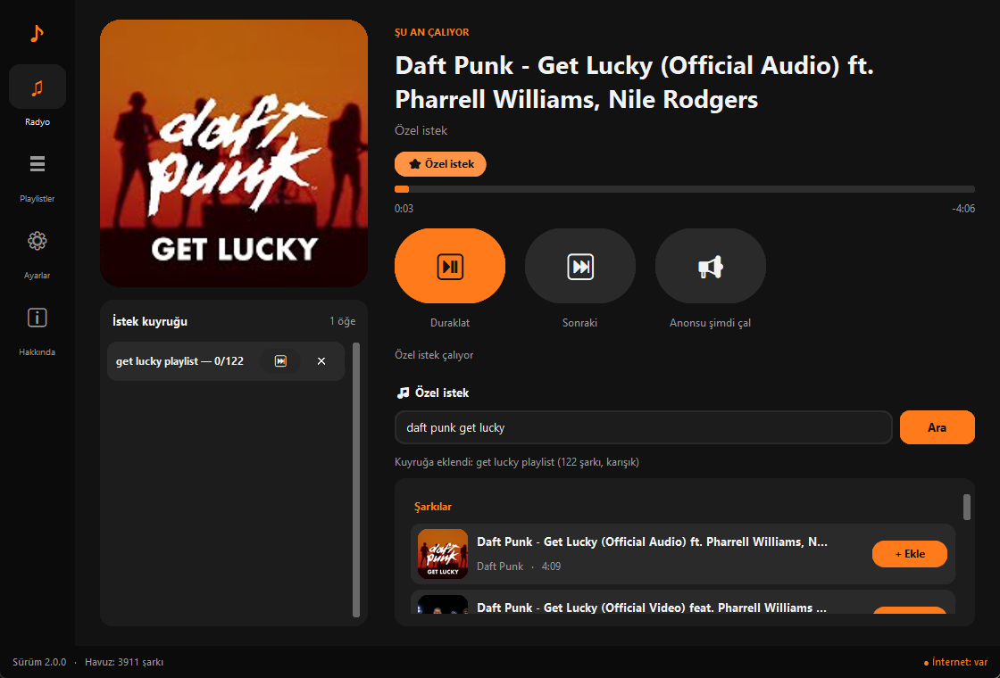
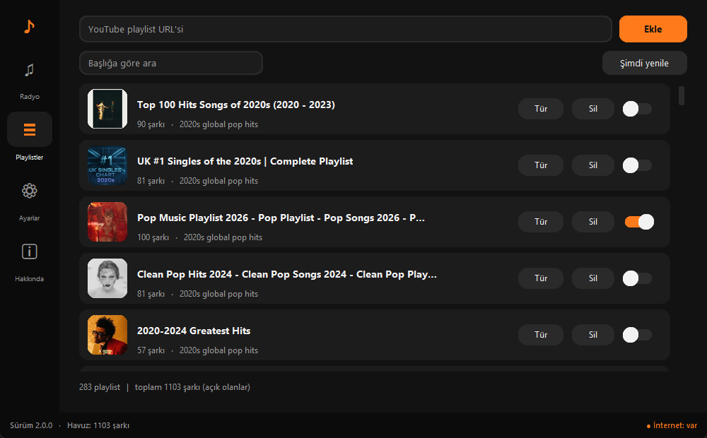
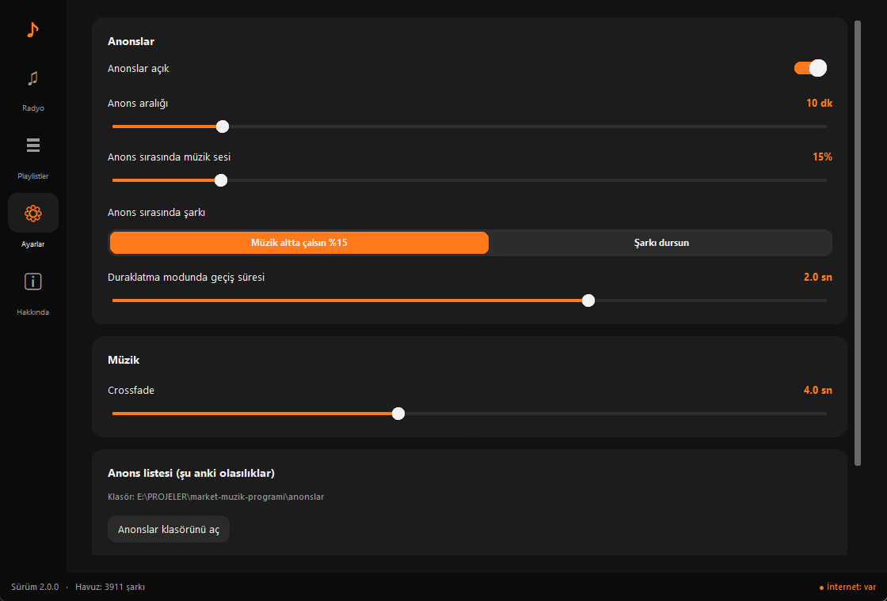
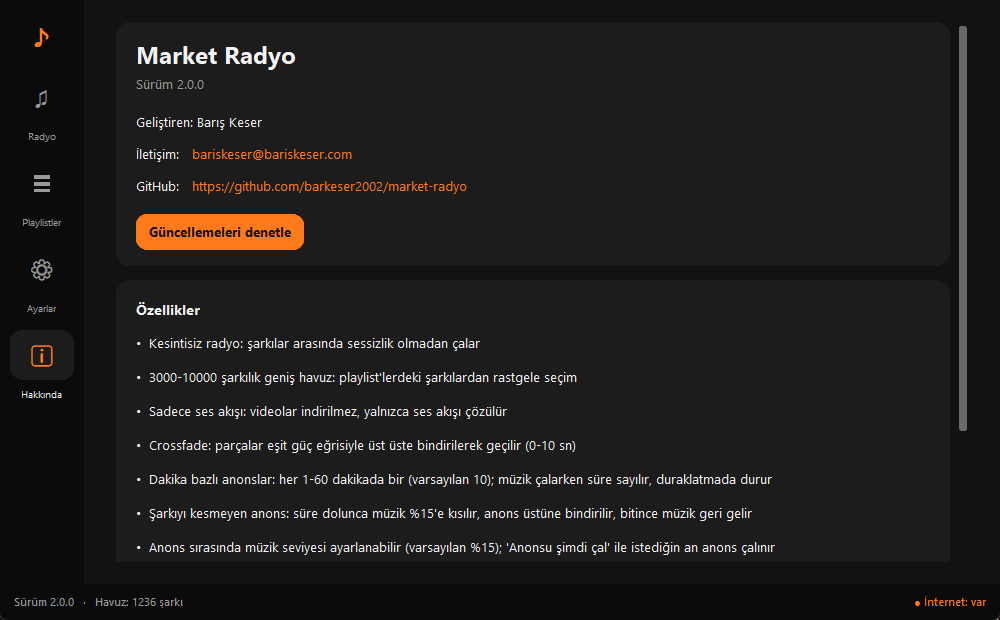

# Market Radyo

Markette sürekli çalan radyo programı. YouTube playlist'lerindeki şarkıları
**indirmeden** stream eder. Araya `anonslar/` klasöründeki `.mp3` anonsları
ağırlıklı rastgele olarak karıştırır.

## Özellikler

- **Kesintisiz radyo:** şarkılar arasında sessizlik olmadan çalar
- **Özel istek:** YouTube'da şarkı veya playlist ara, bağlantı yapıştır; istekler kuyrukta sırayla çalar (kuyruk boşken havuz devam eder)
- **3000-10000 şarkılık geniş havuz:** playlist'lerdeki şarkılardan rastgele seçim
- **Sadece ses akışı:** videolar indirilmez, yalnızca ses akışı çözülür
- **Crossfade:** parçalar eşit güç eğrisiyle üst üste bindirilerek geçilir (0-10 sn)
- **Dakika bazlı anonslar:** her 1-60 dakikada bir (varsayılan 10). Süre yalnızca müzik çalarken sayılır, duraklatmada durur
- **Şarkıyı kesmeyen anons:** süre dolunca şarkı çalmaya devam eder, müzik %15'e (ayarlanabilir) kısılır,
  anons tam sesle üstüne bindirilir ve bitince müzik yaklaşık 1 sn içinde eski sesine döner
- **Şarkı dursun modu:** isteğe bağlı anons modu. Süre dolunca şarkı geçişle kısılıp duraklar, anons tam sesle çalar,
  bitince şarkı kaldığı saniyeden crossfade ile devam eder (geçiş süresi 0-3 sn, varsayılan 2). Bağlantı koparsa
  şarkı aynı konumdan yeniden açılır
- **Özel istek:** YouTube'da şarkı ya da playlist ara (ya da video / playlist bağlantısı yapıştır). Şarkı ya da playlist
  istek kuyruğunun sonuna eklenir ve sırayla çalar; kuyruk boşalınca radyo normal havuzdan devam eder
- **Anons seçimi:** "Anonsu şimdi çal" ile aralıktan bağımsız anons çalınabilir; "Sonraki" yalnızca şarkıyı geçer
- **Akıllı anons rotasyonu:** anonslar ağırlıklı rastgele seçilir, art arda aynısı çalmaz
- **Otomatik format dönüştürme:** mp3 olmayan anonslar açılışta mp3'e çevrilir
- **Playlist ekleme:** YouTube playlist URL'si ile ekleme, tür ve açık/kapalı yönetimi
- **Otomatik güncelleme:** derlenmiş programda yeni sürüm GitHub'dan indirilir ve bir sonraki parça geçişinde kurulur

## Hakkında

- **Program:** Market Radyo
- **Geliştiren:** Barış Keser
- **İletişim:** bariskeser@bariskeser.com
- **GitHub:** https://github.com/barkeser2002/market-radyo

Programın içindeki **Hakkında** sekmesinde aynı bilgiler, sürüm ve bağlantılar bulunur.
**Yardım > Güncellemeleri denetle** ile yeni sürüm hemen aranabilir.

## Gereksinimler

- Windows 10/11 (64-bit). **Hedef cihazda Python gerekmez.**
  Geliştirme ve derleme için Python 3.10+ (64-bit) gerekir.
- **ffmpeg** (zorunlu). Arama sırası: önce `bin\ffmpeg.exe` (proje klasörü), yoksa sistem PATH'i.
  Ses çıkışı için varsayılan bir ses aygıtı gerekir.
- İnternet bağlantısı. YouTube cookie'si **gerekmez**.

## Kurulum ve çalıştırma

Hedef cihaza (radyonun çalacağı bilgisayar) yalnızca `MarketRadyo.exe` ile `anonslar\` klasörü kopyalanır.
Python kurmaya gerek yoktur. Aşağıdaki `.bat` dosyaları yalnızca geliştirme içindir.

- `kurulum.bat`: proje klasöründe `.venv` sanal ortamını oluşturur ve `requirements.txt` ile
  `requirements-dev.txt` (PyInstaller dahil) paketlerini yalnızca bu ortama kurar. Sistem Python'una dokunmaz.
- `calistir.bat`: `.venv` yoksa önce `kurulum.bat`'ı çağırır, sonra programı konsolsuz (`pythonw`) açar.
- `build.bat`: `.venv` yoksa `kurulum.bat`'ı çağırır, `bin\ffmpeg.exe` kontrolü yapar ve
  `MarketRadyo.spec` ile `dist\MarketRadyo.exe` dosyasını derler.

## Ekranlar

Arayüz customtkinter ile yapılmıştır (koyu tema, turuncu vurgu). Sol kenar menüsünde dört sekme vardır;
pencere en az 1000x700 boyutuna kadar daraltılabilir.









**Radyo sekmesi**
- Şu an çalan şarkının kapağı (YouTube küçük resmi), başlığı, playlist ve türü
- İlerleme çubuğu, geçen ve kalan süre
- Duraklat / Devam Et (⏯), Sonraki (⏭), Anonsu şimdi çal (📢) düğmeleri
- Ses kaydırıcısı
- Anons çalarken "ANONS — müzik %15" rozeti (müziğin o anki seviyesi ile)
- "Sıradaki anons: mm:ss" sayacı (duraklatılınca "duraklatıldı" yazar)
- **Özel istek** alanı: arama sonuçları (5 şarkı ve 5 playlist, küçük kapaklarla). Şarkıya **+ Ekle**,
  playlist için **Sırayla** / **Karışık** ile kuyruğa ekleme, **Radyoya ekle** ile playlisti kalıcı listeye alma
- **İstek kuyruğu** paneli (sol altta): her öğe için ✕ ile kaldırma; playlistlerde ⏭ ile o playlistten sonraki şarkıya geçme
  ve "Ad — 12/48" biçiminde ilerleme. İstek çalarken "⭐ Özel istek" rozeti görünür

**Playlistler sekmesi**
- URL yapıştırıp **Ekle**: başlık, kapak ve şarkı sayısı yt-dlp ile çekilir ve kaydedilir
- Başlığa göre arama kutusu
- Kart listesi: küçük kapak, başlık, şarkı sayısı, tür, açık/kapalı anahtarı, **Tür** ve **Sil**
  (silinen playlist güncellemeyle geri gelmez); kapaklar arka planda indirilir ve `data/cache/thumbs/` içinde saklanır
- **Şimdi yenile** ile şarkı listeleri hemen güncellenir

**Ayarlar sekmesi**
- Anonslar açık/kapalı, anons aralığı (1-60 dk), anons sırasında müzik sesi (%), crossfade (0-10 sn)
- Anons sırasında şarkı: "Müzik altta çalsın %X" ya da "Şarkı dursun" (duraklatma modu) ve duraklatma geçiş süresi (0-3 sn)
- Her anonsun o anki çalma olasılığı yüzdesi (son çalan anons bu sefer çalmaz)
- **Anonslar klasörünü aç**

**Hakkında sekmesi**
- Sürüm, geliştirici, iletişim (e-posta) ve GitHub bağlantıları, özellik listesi
- **Güncellemeleri denetle**

Alt durum çubuğunda sürüm, toplam aktif şarkı sayısı, internet durumu ve güncelleme notları görünür.
Üst menüdeki **Yardım** menüsünden de Hakkında ve güncelleme denetimine ulaşılır.

## Nasıl çalışır

- **Şarkı listesi:** Açılışta ve sonrasında 24 saatte bir (arka planda) her playlist
  `yt-dlp` ile (flat, cookie yok) okunur. Sonuç `data/cache/tracks.json` dosyasına yazılır.
- **Karıştırma:** Açık playlist'lerin tüm şarkılarından rastgele seçilir.
  Son 200 çalınan şarkı tekrar edilmez.
- **Çalma:** Şarkının ses akış adresi `yt-dlp` ile çözülür (yalnızca ses, indirme yok), `ffmpeg` ile
  PCM'e çevrilir ve `sounddevice` ile çalınır. Bir sonraki öğe önceden çözülüp tamponlanır.
- **Crossfade:** Parça bitmeden `crossfade_sec` saniye (varsayılan 4, 0-10) önce sonraki şarkı
  başlar; iki ses eşit güç (equal-power) eğrisiyle karıştırılır. `config.json` içinde ayarlanır.
  "Sonraki" düğmesi kısa (0,4 sn) bir geçiş yapar.
  Şarkı hata verirse atlanır. İnternet koparsa bağlantı gelene kadar bekleyip şarkıyı tekrar dener.
- **Anons zamanlaması:** `announce_every_min` (varsayılan 10) dakikalık sayaç yalnızca müzik çalarken işler.
  Süre dolunca anons şarkıyı kesmez veya crossfade kuyruğuna girmez. Müzik `duck_level`
  (varsayılan 0.15) değerine yaklaşık 0,5 sn içinde iner, anons ayrı kanalda tam sesle çalar,
  anons bitince müzik yaklaşık 1 sn içinde eski sesine döner. Anons modu `"pause"` ise şarkı
  `announce_fade_sec` (varsayılan 2) içinde kısılıp duraklar; akış kapatılmaz. Anons bitince şarkı kaldığı
  saniyeden equal-power geçişle devam eder. Akış bozulmuşsa aynı adresten `ffmpeg -ss <konum>` ile yeniden açılır.
  Anons sırasında şarkı biterse sonraki
  şarkıya normal crossfade %15 seviyesinde geçer. Ana ses kaydırıcısı hem müziği hem anonsu etkiler.
- **Mixer kanalları (`audio.py`):** Müzik ve anons ayrı kanallarda üretilir ve toplanır. Toplam
  yumuşak sınırlandırılır (soft limit), böylece taşma (clipping) olmaz.
- **Anons seçimi (`ads.py`):**
  - En son çalan anonsun ağırlığı 0. 2 veya daha fazla dosya varsa art arda aynısı çalmaz.
  - Diğer anonsların ağırlığı, en son çalınmasından bu yana geçen anons sayısıdır.
    Uzun süredir çalmayan anons daha yüksek olasılıkla seçilir.
  - Tek dosya varsa her zaman o çalar.

## Güncelleme nasıl yayınlanır

1. Kodda değişikliği yapın ve `python -m unittest discover -s tests` ile test edin.
2. `version.txt` içindeki sürümü artırın (ör. `1.0.0` -> `1.0.1`) ve commit + push edin.
3. Programı tek dosya exe olarak derleyin (sürüm dosyası exe'nin içine gömülür). `build.bat` bunu yapar:

```
build.bat
```

`build.bat` `MarketRadyo.spec` dosyasını `.venv\Scripts\pyinstaller.exe` ile çalıştırır.

4. Exe'nin sha256 özetini yazın (ör. PowerShell: `Get-FileHash dist\MarketRadyo.exe -Algorithm SHA256`),
   `MarketRadyo.exe.sha256` dosyasına `<hash>  MarketRadyo.exe` biçiminde kaydedin.
5. GitHub'da `vX.Y.Z` etiketiyle yeni bir Release oluşturun ve `dist\MarketRadyo.exe` ile
   `MarketRadyo.exe.sha256` dosyalarını ekleyin.

Markettekiler bir sonraki denetimde (açılış ya da en fazla 6 saat içinde) yeni sürümü indirir.
Yeni sürüm, çalan parça bittiğinde bir sonraki parça geçişinde kurulur ve program yeniden başlar.
`config.json` ve `data/` güncellemede değişmez.

## Otomatik güncelleme

- `config.json` içindeki `update_repo` (`barkeser2002/market-radyo`) ve `update_branch` (`main`) kullanılır.
  `update_repo` `OWNER/...` ise güncelleme kontrolü yapılmaz. Varsayılan (config.json yoksa) `barkeser2002/market-radyo` tur.
- Açılışta ve her 6 saatte bir arka planda GitHub Releases'ten en son sürüm (`vX.Y.Z` etiketi) denetlenir.
  Token gerekmez.
- **Derlenmiş exe:** Yeni sürümün `MarketRadyo.exe` ve `MarketRadyo.exe.sha256` dosyaları indirilir,
  sha256 doğrulanır ve exe'nin yanına `MarketRadyo.exe.new` olarak yazılır. Hash tutmazsa dosya atılır.
  Kurulum `data\update.bat` ile yapılır: program kapanır, exe değiştirilir, başarısız olursa eski exe
  geri konur, yeni sürüm başlatılır ve bat dosyası silinir. Kurulum çalma sırasında anında olmaz,
  bir sonraki parça geçişinde yapılır.
- **Kaynak (python) kurulum:** Yeni sürüm yalnızca bildirilir; güncellemeyi elle alın.
- Uzaktaki `data/playlists.json` da arka planda okunur. Yeni playlist'ler eklenir,
  sizin eklediklerinize, açık/kapalı ayarlarınıza ve türlere dokunulmaz.
- `config.json` ve `data/` güncellemede üzerine yazılmaz.

## Klasör yapısı

```
main.py          giriş noktası
config.py        config.json okuma ve ayar kaydetme
gui.py           customtkinter arayüzü (koyu tema), Yardım menüsü (Hakkında, güncelleme denetimi)
player.py        yt-dlp akış çözme, anons/şarkı sırası, geçiş planlama
audio.py         ffmpeg PCM akışı, sounddevice çıkışı, crossfade, anons duck ve duraklatma karıştırıcısı
istek.py         özel istek: YouTube araması, bağlantı çözümü, istek kuyruğu
ffmpeg_util.py   ffmpeg konumu (bin/, PATH, PyInstaller)
playlists.py     playlist kütüphanesi, şarkı önbelleği
ads.py           anons seçimi (ağırlıklı rastgele) ve mp3'e dönüştürme
updater.py       GitHub Releases üzerinden sürüm denetimi, sha256 doğrulama, kurulum
config.json      ayarlar (ses, anons aralığı (dk), anons sırasında müzik seviyesi, anons modu (announce_mode),
                 duraklatma geçişi (announce_fade_sec), crossfade, güncelleme deposu)
version.txt      sürüm numarası
requirements.txt bağımlılıklar (çalışma zamanı)
requirements-dev.txt  geliştirme bağımlılıkları (requirements.txt + pyinstaller)
MarketRadyo.spec PyInstaller derleme tarifi
kurulum.bat      .venv oluşturur ve bağımlılıkları kurar (yalnızca geliştirme)
calistir.bat     kur ve çalıştır (yalnızca geliştirme)
build.bat        exe derler (yalnızca geliştirme)
anonslar/        çalınacak anons .mp3 dosyaları
data/
  playlists.json   playlist listesi
  parts/*.json     ek playlist listeleri (aynı biçim, açılışta birleşir)
  dismissed.json   silinen playlist id'leri
  cache/           şarkı listesi önbelleği ve kapak resimleri (otomatik oluşur)
  radyo.log        günlük
tests/          anons seçimi, anons dönüştürme, crossfade, anons duck/dakika zamanlayıcı, duraklatma modu,
                 istek kuyruğu, güncelleme ve ayar testleri; test_istek_live.py internet varsa YouTube'a bağlanır
```

## Playlist kaydı biçimi

`data/playlists.json` içinde:

```json
[
  {
    "id": "PLxxxxxxxxxxxxxxxx",
    "url": "https://www.youtube.com/playlist?list=PLxxxxxxxxxxxxxxxx",
    "title": "Yabancı Pop",
    "thumbnail": "https://i.ytimg.com/...",
    "count": 250,
    "genre": "pop",
    "enabled": true
  }
]
```

## Testler

```
python -m unittest discover -s tests -v
```

## Sınırlar

- Akış adresleri birkaç saat geçerlidir. Program 90 dakikadan eski adresleri yeniler.
- Geçişler crossfade ile yapılır; crossfade_sec 0 yapılırsa şarkılar arasında kısa bir boşluk olabilir.
- YouTube değişiklikleri veya bölge kısıtları bazı şarkıların çalmamasına yol açabilir. Bu şarkılar atlanır.
